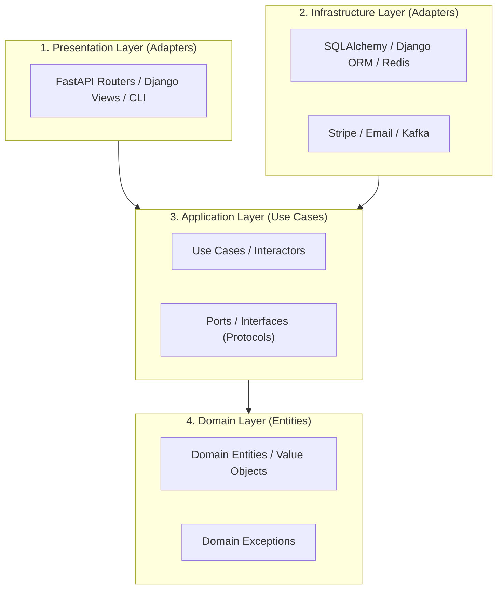

# Step 1.1: Clean Architecture & DDD ใน Python (FastAPI / Django) 🏛️

---

## 📌 1. ปัญหาของสถาปัตยกรรมแบบดั้งเดิม (Fat Controller / Fat Model)

ในโปรเจกต์ทั่วไป เรามักจะเห็นโค้ดที่รวมทุกอย่างไว้ใน Endpoint เดียวกัน:

```text
[HTTP Request]
      ⬇
[FastAPI Router / Django View]
      ├── 1. Validate Schema
      ├── 2. Business Logic (คำนวณส่วนลด, เช็คสต็อก)
      ├── 3. Database Queries (ORM / SQL โดยตรง)
      ├── 4. เรียก External API (Stripe, Email)
      └── 5. Return HTTP Response
```

### ❌ ข้อเสียเมื่อระบบขยายใหญ่:

- **ผูกติด Framework & ORM:** หากวันหนึ่งต้องการเปลี่ยน ORM, ย้ายจาก Django เป็น FastAPI, หรือเปลี่ยนเป็น CLI/Worker จะต้องเขียนโค้ดใหม่เกือบทั้งหมด
- **Unit Test ยากและช้ามาก:** ทุกครั้งที่ต้องการทดสอบ Business logic จะต้อง Start Test Database หรือ Mock ORM ที่ซับซ้อน
- **โค้ดเปราะบาง (Fragile):** การแก้ query ฐานข้อมูลอาจส่งผลกระทบต่อ logic การคำนวณเงินโดยไม่ตั้งใจ

---

## 🎯 2. หลักการของ Clean Architecture (The Dependency Rule)

หัวใจสำคัญที่สุดของ Clean Architecture คือ **"Dependency Rule (กฎการพึ่งพา)"**:

> **"โค้ดชั้นใน (Core Logic) ต้องไม่รู้จักโค้ดชั้นนอก (Database, Web Framework, External APIs)"**



### หน้าที่ของแต่ละ Layer:

| Layer                 | หน้าที่                                                 | พึ่งพาอะไรบ้าง? (Imports)                                     |
| :-------------------- | :------------------------------------------------------ | :------------------------------------------------------------ |
| **1. Domain**         | แก่นของธุรกิจ (Entities, Value Objects, Business Rules) | **Pure Python เท่านั้น** (ห้าม import ORM, FastAPI, requests) |
| **2. Application**    | รวมขั้นตอนการทำงาน (Use Cases, DTOs, Port Interfaces)   | พึ่งพาเฉพาะ **Domain**                                        |
| **3. Infrastructure** | ต่อกับโลกภายนอก (Database Repository, Payment Gateway)  | Implement Ports จาก **Application**                           |
| **4. Presentation**   | รับ HTTP Request, แปลง Payload, เรียก Use Case          | พึ่งพา **Application DTOs & Use Cases**                       |

---

## 💻 3. ตัวอย่างโค้ดเปรียบเทียบ: ระบบสร้าง Order และชำระเงิน

---

### ❌ แบบดั้งเดิม (Fat Controller / Coupled Code)

```python
# routers/orders.py (FastAPI)
from fastapi import APIRouter, HTTPException, Depends
from sqlalchemy.orm import Session
import stripe

router = APIRouter()

@router.post("/orders")
def create_order(payload: OrderCreateSchema, db: Session = Depends(get_db)):
    # 1. เช็คสต็อก (ผูกกับ SQLAlchemy โดยตรง)
    product = db.query(ProductModel).filter(ProductModel.id == payload.product_id).first()
    if not product or product.stock < payload.quantity:
        raise HTTPException(status_code=400, detail="Out of stock")

    # 2. คำนวณราคา (Business logic ปนอยู่ใน Controller)
    total_price = product.price * payload.quantity
    if payload.coupon_code == "SUMMER10":
        total_price *= 0.9

    # 3. ตัดเงิน (ผูกกับ Third-party โดยตรง)
    try:
        charge = stripe.Charge.create(amount=int(total_price * 100), currency="thb", source=payload.token)
    except stripe.error.CardError:
        raise HTTPException(status_code=402, detail="Payment failed")

    # 4. บันทึกลงฐานข้อมูล
    product.stock -= payload.quantity
    order = OrderModel(product_id=product.id, total_price=total_price, status="PAID", charge_id=charge.id)
    db.add(order)
    db.commit()

    return {"order_id": order.id, "status": order.status}
```

---

### แบบ Clean Architecture

#### Layer 1: Domain Layer (`domain/order.py`)

_ใช้ Pure Python (`dataclass`), ไม่พึ่งพา DB หรือ Framework ใดๆ_

```python
# domain/order.py
from dataclasses import dataclass
from enum import Enum
from decimal import Decimal

class OrderStatus(str, Enum):
    PENDING = "PENDING"
    PAID = "PAID"
    CANCELLED = "CANCELLED"

@dataclass
class Order:
    id: str | None
    product_id: str
    quantity: int
    unit_price: Decimal
    status: OrderStatus = OrderStatus.PENDING
    charge_id: str | None = None

    def calculate_total(self, discount_percent: Decimal = Decimal(0)) -> Decimal:
        raw_total = self.unit_price * self.quantity
        discount = raw_total * (discount_percent / Decimal(100))
        return raw_total - discount

    def mark_as_paid(self, charge_id: str) -> None:
        if self.status != OrderStatus.PENDING:
            raise ValueError("Only pending orders can be marked as paid")
        self.status = OrderStatus.PAID
        self.charge_id = charge_id
```

---

#### Layer 2: Application Layer (`application/`)

**2.1 ประกาศ Port (Interface) โดยใช้ Python `typing.Protocol`**

```python
# application/ports.py
from typing import Protocol
from decimal import Decimal
from domain.order import Order

class OrderRepository(Protocol):
    def save(self, order: Order) -> Order: ...
    def get_by_id(self, order_id: str) -> Order | None: ...

class ProductStockService(Protocol):
    def check_and_reserve_stock(self, product_id: str, quantity: int) -> Decimal: ...

class PaymentGateway(Protocol):
    def charge(self, amount: Decimal, token: str) -> str: ...
```

**2.2 สร้าง Use Case (Interactor)**

```python
# application/use_cases/create_order.py
from dataclasses import dataclass
from decimal import Decimal
from domain.order import Order
from application.ports import OrderRepository, ProductStockService, PaymentGateway

@dataclass(frozen=True)
class CreateOrderCommand:
    product_id: str
    quantity: int
    coupon_code: str | None
    payment_token: str

@dataclass(frozen=True)
class CreateOrderResult:
    order_id: str
    status: str
    total_amount: Decimal

class CreateOrderUseCase:
    def __init__(
        self,
        order_repo: OrderRepository,
        stock_service: ProductStockService,
        payment_gateway: PaymentGateway,
    ):
        self.order_repo = order_repo
        self.stock_service = stock_service
        self.payment_gateway = payment_gateway

    def execute(self, command: CreateOrderCommand) -> CreateOrderResult:
        # 1. เช็คสต็อกและรับราคาต่อหน่วย
        unit_price = self.stock_service.check_and_reserve_stock(command.product_id, command.quantity)

        # 2. สร้าง Domain Entity
        order = Order(
            id=None,
            product_id=command.product_id,
            quantity=command.quantity,
            unit_price=unit_price
        )

        # 3. คำนวณส่วนลดตาม Business Rule
        discount = Decimal(10) if command.coupon_code == "SUMMER10" else Decimal(0)
        total_amount = order.calculate_total(discount_percent=discount)

        # 4. ตัดเงินผ่าน Payment Gateway Port
        charge_id = self.payment_gateway.charge(amount=total_amount, token=command.payment_token)

        # 5. เปลี่ยนสถานะและบันทึกลง Repository Port
        order.mark_as_paid(charge_id=charge_id)
        saved_order = self.order_repo.save(order)

        return CreateOrderResult(
            order_id=saved_order.id,
            status=saved_order.status.value,
            total_amount=total_amount
        )
```

---

#### Layer 3: Infrastructure Layer (`infrastructure/`)

_Implement Adapter ตาม Port ที่ Application ชั้นในกำหนดไว้_

```python
# infrastructure/adapters/stripe_payment.py
import stripe
from decimal import Decimal
from application.ports import PaymentGateway

class StripePaymentGateway(PaymentGateway):
    def charge(self, amount: Decimal, token: str) -> str:
        charge = stripe.Charge.create(
            amount=int(amount * 100),
            currency="thb",
            source=token
        )
        return charge.id

# infrastructure/repositories/sqlalchemy_order_repository.py
from sqlalchemy.orm import Session
from domain.order import Order
from application.ports import OrderRepository

class SqlAlchemyOrderRepository(OrderRepository):
    def __init__(self, db_session: Session):
        self.session = db_session

    def save(self, order: Order) -> Order:
        orm_order = OrderORMModel(
            product_id=order.product_id,
            quantity=order.quantity,
            unit_price=order.unit_price,
            status=order.status.value,
            charge_id=order.charge_id
        )
        self.session.add(orm_order)
        self.session.commit()
        order.id = str(orm_order.id)
        return order
```

---

#### Layer 4: Presentation Layer (`presentation/api/orders.py`)

_ทำหน้าที่แปลง HTTP -> Command DTO และเรียก Use Case เท่านั้น_

```python
# presentation/api/orders.py
from fastapi import APIRouter, Depends, HTTPException
from pydantic import BaseModel
from application.use_cases.create_order import CreateOrderUseCase, CreateOrderCommand
from infrastructure.dependencies import get_create_order_use_case

router = APIRouter()

class CreateOrderRequest(BaseModel):
    product_id: str
    quantity: int
    coupon_code: str | None = None
    payment_token: str

@router.post("/orders")
def create_order_endpoint(
    req: CreateOrderRequest,
    use_case: CreateOrderUseCase = Depends(get_create_order_use_case)
):
    try:
        command = CreateOrderCommand(
            product_id=req.product_id,
            quantity=req.quantity,
            coupon_code=req.coupon_code,
            payment_token=req.payment_token
        )
        result = use_case.execute(command)
        return {"order_id": result.order_id, "status": result.status, "amount": float(result.total_amount)}
    except ValueError as e:
        raise HTTPException(status_code=400, detail=str(e))
```

---

## 🧪 4. ประโยชน์สูงสุด: Unit Testing ที่เร็วระดับ Milliseconds

ด้วย Clean Architecture เราสามารถทดสอบ Use Case ทั้งหมดได้โดยไม่ต้องเปิด Database หรือเรียก Stripe จริงเลย:

```python
# tests/unit/test_create_order_use_case.py
from decimal import Decimal
from domain.order import Order, OrderStatus
from application.use_cases.create_order import CreateOrderUseCase, CreateOrderCommand

# สร้าง Fake Adapter ง่ายๆ ใน Memory
class FakeOrderRepo:
    def __init__(self):
        self.saved_orders = []
    def save(self, order: Order) -> Order:
        order.id = "order-123"
        self.saved_orders.append(order)
        return order

class FakeStockService:
    def check_and_reserve_stock(self, product_id: str, quantity: int) -> Decimal:
        return Decimal(100)  # ราคาชิ้นละ 100 บาท

class FakePaymentGateway:
    def charge(self, amount: Decimal, token: str) -> str:
        return "ch_fake_12345"

def test_create_order_with_coupon_success():
    # Arrange
    repo = FakeOrderRepo()
    use_case = CreateOrderUseCase(
        order_repo=repo,
        stock_service=FakeStockService(),
        payment_gateway=FakePaymentGateway()
    )
    command = CreateOrderCommand(
        product_id="prod-1",
        quantity=2,
        coupon_code="SUMMER10",
        payment_token="tok_test"
    )

    # Act
    result = use_case.execute(command)

    # Assert
    assert result.status == OrderStatus.PAID.value
    assert result.total_amount == Decimal(180)  # (100 * 2) - 10% = 180
    assert len(repo.saved_orders) == 1
    assert repo.saved_orders[0].charge_id == "ch_fake_12345"
```

_ผลลัพธ์: การทดสอบนี้รันเสร็จในเวลา **< 5 milliseconds** โดยไม่ต้องใช้ Docker, DB หรือ Mock ซับซ้อน!_
