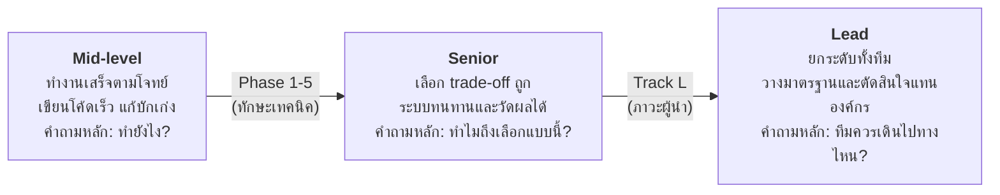
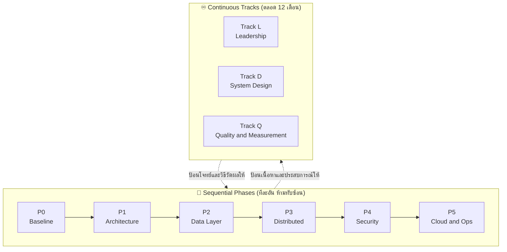
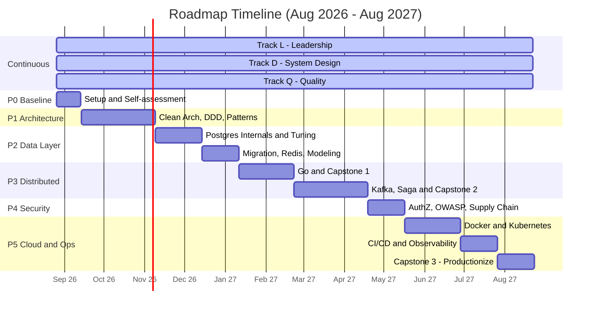

# Roadmap สู่ Senior / Lead Backend Engineer 🚀

> **เวอร์ชัน 2** — ออกแบบใหม่ทั้งหมด (26 ส.ค. 2026)
> ระยะเวลา ~12 เดือน · ส.ค. 2026 – ส.ค. 2027 · สมมติฐาน ~10 ชม./สัปดาห์ นอกเวลางาน

เอกสารนี้ไม่ใช่รายการหัวข้อให้ไล่อ่าน แต่เป็น **แผนปฏิบัติการที่มีเกณฑ์ผ่านวัดผลได้** สำหรับ Mid-level Developer ที่ต้องการก้าวสู่ Senior / Lead

---

## 📖 วิธีใช้เอกสารนี้

อ่านสามข้อนี้ก่อนเริ่ม เพราะมันคือสิ่งที่ทำให้ roadmap นี้ต่างจากที่เคยเขียนไว้เวอร์ชันแรก

| หลักการ | ความหมายในทางปฏิบัติ |
| :--- | :--- |
| **1. ไม่มี block "นั่งอ่านทฤษฎี" เดี่ยวๆ** | ทุกหัวข้อต้องจบด้วยสิ่งที่จับต้องได้ — โค้ดที่รันได้, ตัวเลข benchmark, หรือเอกสารที่มีคนรีวิว |
| **2. ผ่าน Phase ด้วย Exit Criteria ไม่ใช่ด้วยวันที่** | ทำเกณฑ์ท้าย Phase ไม่ได้ = ยังไม่ขึ้น Phase ถัดไป ต่อให้เลยกำหนดแล้ว วันที่ใน Gantt คือ *ประมาณการ* ไม่ใช่คำสั่ง |
| **3. ทุกอย่างลงใน repo นี้ที่เดียว** | ADR, System Design writeup, ผล benchmark, post-mortem ทั้งหมดลงใน [`journal/`](./journal/) — สิ้นปีนี่คือ **portfolio ที่ใช้สัมภาษณ์ได้จริง** ไม่ใช่แค่บันทึกส่วนตัว |

---

## 🧭 Mindset Shift ที่ต้องเกิดขึ้น

**ข้อสังเกตสำคัญ**: Phase 1–5 ทั้งหมดพาไปได้แค่ถึง Senior เท่านั้น สิ่งที่พาข้ามไป Lead คือ Track L ซึ่งฝึกจากการอ่านไม่ได้ ต้องฝึกกับคนจริง — จึงต้องเดินคู่ขนานตั้งแต่สัปดาห์แรก ไม่ใช่รอทำตอนจบ

---

## 🗺️ โครงสร้างภาพรวม

โครงสร้างมีสองแกน: **Phase ที่เดินทีละอัน** และ **Track ที่เดินตลอดเวลา**

### งบเวลาต่อสัปดาห์ (~10 ชม.)

| ส่วน | ชม./สัปดาห์ | หมายเหตุ |
| :--- | :---: | :--- |
| Phase ปัจจุบัน | **6–7** | ก้อนหลัก อ่าน + เขียนโค้ด + Capstone |
| Track D — System Design | **1.5** | สัปดาห์ละ 1 โจทย์ จับเวลา |
| Track Q — Quality | **~1** | ส่วนใหญ่แทรกในงานประจำ ไม่ใช่เวลาเพิ่ม |
| Track L — Leadership | **~0.5** | เกิดในเวลางานเกือบทั้งหมด (รีวิว, เขียน ADR, mentoring) |

> Track L และ Q ออกแบบให้ "แทบไม่กินเวลาเพิ่ม" โดยตั้งใจ เพราะมันเกิดระหว่างทำงานประจำอยู่แล้ว สิ่งที่เปลี่ยนคือ **ทำอย่างตั้งใจและบันทึกไว้** ไม่ใช่ทำผ่านๆ

---

# ♾️ ส่วนที่ 1: Continuous Tracks

สามแทร็กนี้เริ่มวันแรกและไม่มีวันจบ เป็นตัวที่กันไม่ให้ความรู้จาก Phase ต่างๆ หายไปภายใน 2–3 เดือน

## Track L — Technical Leadership *(สิ่งที่แยก Senior ออกจาก Lead)*

### L.1 Technical Writing & Decision Records
- **ADR (Architecture Decision Record)**: context → options considered → decision → consequences
  - รูปแบบเริ่มต้นที่ดีที่สุดคือของ Michael Nygard สั้นและใช้ได้จริง
- **RFC / Design Doc**: เสนอการเปลี่ยนแปลงระดับระบบให้ทีมรีวิว *ก่อน* ลงมือเขียนโค้ด
- **แปลเทคนิคเป็นภาษาธุรกิจ**: อธิบาย trade-off ให้ PM/ผู้บริหารในหน่วยของ cost, risk, time-to-market ไม่ใช่ในหน่วยของ latency

### L.2 Team Standards & Mentoring
- นำ **Design Review** และทำ **Code Review ที่สอน** ไม่ใช่จับผิด (แยกให้ออกระหว่าง "ต้องแก้" กับ "ความชอบส่วนตัว")
- วางมาตรฐานทีม: coding convention, definition of done, testing strategy, PR template
- **มาตรฐานการใช้ AI coding tools ในทีม** — หัวข้อที่ Lead ปี 2026 เลี่ยงไม่ได้:
  - งานประเภทไหนไว้ใจ AI ได้ / ประเภทไหนต้องคนตรวจทุกบรรทัด (เช่น auth, การคำนวณเงิน, migration)
  - ระดับการรีวิวโค้ดที่ AI เขียน และความรับผิดชอบยังอยู่ที่คน commit เสมอ
  - ผลกระทบต่อ junior — ป้องกันไม่ให้ข้ามขั้นการเข้าใจพื้นฐาน
- Mentoring: ให้ feedback ที่ actionable, มอบหมายงานที่ท้าทายพอดี (ไม่ใช่งานเหลือ)

### L.3 Incident Leadership
- บทบาท **Incident Commander**: สื่อสารระหว่างเกิดเหตุ, ตัดสินใจภายใต้ข้อมูลไม่ครบ, กันคนอื่นออกจากทางของคนแก้
- นำ **Blameless Post-mortem** และทำให้ action item เกิดขึ้นจริง ไม่ใช่เขียนทิ้งไว้ในเอกสาร

### 🎯 เกณฑ์วัดผล Track L (ต่อไตรมาส)
- [ ] เขียน ADR จริงในโปรเจกต์ที่ทำงานอยู่ **อย่างน้อย 1 ฉบับ** และมีคนในทีมรีวิว
- [ ] นำ design review หรือ tech sharing ในทีม **อย่างน้อย 1 ครั้ง**
- [ ] เขียน post-mortem หรือ retrospective note จาก incident/ปัญหาจริง **อย่างน้อย 1 ครั้ง**

### 📚 แหล่งอ้างอิง
- **The Staff Engineer's Path** — Tanya Reilly *(หลัก — ตรงกับช่วงเปลี่ยนผ่าน Senior → Lead ที่สุด)*
- **Staff Engineer** — Will Larson · `staffeng.com`
- **Google Engineering Practices** — `google.github.io/eng-practices` *(ส่วน code review ฟรีและใช้ได้ทันที)*
- `adr.github.io` — เทมเพลตและตัวอย่าง ADR

---

## Track D — System Design Practice *(สัปดาห์ละ 1 โจทย์)*

ฝึกออกแบบระบบทั้งก้อนจากศูนย์ ซึ่งเป็นทักษะคนละตัวกับการรู้จัก pattern แยกชิ้น และเป็นสิ่งที่สัมภาษณ์ระดับ Senior/Staff วัดจริง

**รูปแบบคงที่ 45–60 นาที จับเวลา:**
1. ถามให้ชัดว่าโจทย์คืออะไร (functional + non-functional requirements)
2. **ประมาณ capacity** — QPS, storage, bandwidth (ทำก่อนวาด ไม่ใช่ทำทีหลัง)
3. วาด high-level architecture
4. เจาะลึก 1–2 จุดที่ยากที่สุด
5. **ระบุ bottleneck และ single point of failure ด้วยตัวเอง** ก่อนที่คนอื่นจะถาม
6. สรุป trade-off ที่เลือกและที่ทิ้งไป

**ลำดับโจทย์ (ไล่จากง่ายไปยาก):**

| ช่วง | โจทย์ | ทดสอบอะไร |
| :--- | :--- | :--- |
| เดือน 1–3 | URL Shortener → Rate Limiter → Web Crawler | Estimation, caching, hashing, พื้นฐาน |
| เดือน 4–6 | News Feed → Chat System → Notification Service | Fan-out, real-time, message queue |
| เดือน 7–9 | Payment Ledger → Ticket Booking → Distributed Job Scheduler | Consistency, idempotency, transaction ข้ามระบบ |
| เดือน 10–12 | Ride-hailing Dispatch → Metrics/Monitoring System → Multi-region Deployment | Geo-spatial, time-series, global scale |

**กติกาที่ห้ามข้าม**: เขียนคำตอบเป็นเอกสารเก็บใน journal ทุกครั้ง แล้ว**ย้อนกลับมาทำโจทย์เดิมซ้ำหลังจบทุก Phase** — การเห็นว่าคำตอบตัวเองเปลี่ยนไปยังไงคือหลักฐานความก้าวหน้าที่ชัดที่สุด และหลอกตัวเองไม่ได้

### 📚 แหล่งอ้างอิง
- **System Design Interview Vol. 1 & 2** — Alex Xu *(ใช้เป็นชุดโจทย์และเฉลยเทียบ)*
- **Designing Data-Intensive Applications (DDIA)** — Martin Kleppmann *(หนังสือที่สำคัญที่สุดใน roadmap นี้ — ครอบคลุม Phase 2 และ 3 เกือบทั้งหมด อ่านคู่ขนานไปตลอด)*
- `bytebytego.com` · `github.com/donnemartin/system-design-primer`

---

## Track Q — Quality & Measurement *(ทักษะที่หายไปจาก roadmap ส่วนใหญ่)*

แทร็กนี้ตอบคำถามสองข้อที่ Senior ต้องตอบได้เสมอ: **"รู้ได้ยังไงว่ามันถูก?"** และ **"รู้ได้ยังไงว่ามันเร็วพอ?"**

### Q.1 Testing Strategy — ระดับที่ Lead ต้องวางให้ทั้งทีม
- **Test pyramid & test doubles**: แยกให้ออกระหว่าง mock, stub, fake, spy และเลือกใช้ให้ถูก
- **Testcontainers** — ทดสอบกับ Postgres/Kafka/Redis ตัวจริงใน CI แทนการ mock ทั้งหมด *(เชื่อมกับ Phase 2 และ 3 โดยตรง)*
- **Contract Testing (Pact)** — จำเป็นทันทีที่มีบริการมากกว่า 1 ตัวคุยกัน มิฉะนั้นจะพังตอน integrate *(เชื่อมกับ Capstone 2 และ 3)*
- **Property-based testing** (Hypothesis) — เหมาะกับ business rule ที่มีเงื่อนไขซับซ้อนอย่างระบบเงิน
- **Flaky test management** — ทำไมเทสไม่เสถียรถึงอันตรายกว่าเทสที่ fail และวิธีจัดการเชิงระบบ

### Q.2 Performance Measurement — ห้ามอ้างว่าเร็วถ้าวัดไม่ได้
- **อ่านผลเป็น percentile**: p50 / p95 / p99 — **ห้ามใช้ค่าเฉลี่ย** เพราะมันกลบปัญหา tail latency ซึ่งเป็นสิ่งที่ผู้ใช้เจอจริง
- **Load testing**: k6 หรือ Locust — ออกแบบ load profile, หา breaking point, แยก smoke / load / stress / soak test
- **Profiling**: `pprof` (Go), `py-spy` / `cProfile` (Python), อ่าน flame graph เป็น
- **Capacity estimation** — ป้อนกลับเข้า Track D โดยตรง

### 🎯 เกณฑ์วัดผล Track Q
- [ ] ทุก Capstone ต้องมีตัวเลข benchmark ก่อน/หลัง optimization บันทึกไว้ใน journal
- [ ] อย่างน้อย 1 ครั้ง: หา bottleneck จริงด้วย profiler แล้วแก้ พร้อมตัวเลขยืนยัน

### 📚 แหล่งอ้างอิง
- **Unit Testing: Principles, Practices, and Patterns** — Vladimir Khorikov *(หลัก — เปลี่ยนวิธีคิดเรื่อง mock ไปเลย)*
- **Systems Performance** — Brendan Gregg *(อ้างอิงเชิงลึก ไม่ต้องอ่านรวด)*
- เอกสารทางการ: `testcontainers.com` · `k6.io/docs` · `docs.pact.io`

---

# 🔁 ส่วนที่ 2: Sequential Phases

---

## Phase 0 · Baseline & Setup

**⏱️ 26 ส.ค. – 13 ก.ย. 2026 (~2.5 สัปดาห์)**

Phase สั้นๆ ที่คนมักข้าม แต่เป็นตัวที่ทำให้วัดความก้าวหน้าได้จริงตลอด 12 เดือน

### ✅ ทำไปแล้ว
- [x] ~~สร้าง repo พร้อมโครง `journal/`: `adr/` · `system-design/` · `benchmarks/` · `post-mortems/`~~ *(27 ส.ค. 2026)*
- [x] ~~จัดสภาพแวดล้อม: Postgres + Redis + Kafka~~ → [`dev-env/`](./dev-env/) *(27 ส.ค. 2026 — ทดสอบขึ้น healthy ครบแล้ว)*
- [x] ~~**ทำโจทย์ System Design แรก (URL Shortener)**~~ → [คำตอบ](./journal/system-design/2026-08-27-url-shortener.md) · [รีวิว](./journal/system-design/2026-08-27-url-shortener-review.md) *(27 ส.ค. 2026 — ทำแบบไม่ค้นหา ไม่ถาม AI ตามกติกา)*
  - 🔁 **เอากลับมาทำซ้ำหลังจบทุก Phase** แล้วเทียบกับรอบนี้ — เกณฑ์วัดอยู่ท้ายไฟล์รีวิว
- [x] ~~**ประเมินตัวเอง** ทุกหัวข้อของ Phase 1–5~~ → [`self-assessment.md`](./self-assessment.md) *(27 ส.ค. 2026)*

### 📝 เหลือ 1 ข้อ
- [ ] **เลือกโปรเจกต์จริงในงาน** ที่จะใช้เป็นสนามทดลองของ **Phase 1**
  - เกณฑ์: มีสิทธิ์ refactor ได้จริง · เข้าใจ domain ดีที่สุด · มี stakeholder จริงให้คุยเรื่อง design
  - ⚠️ **ไม่ต้องใช้เกณฑ์เรื่อง scale** — งานปัจจุบันเป็น SaaS ขนาดเล็ก จะไม่มี query ช้าให้ tune ตามธรรมชาติ

> ### 🎯 สนามทดลองมี 2 สนาม อย่าให้งานประจำแบกทั้งหมด
>
> | สนาม | ใช้กับ Phase | เหตุผล |
> | :--- | :--- | :--- |
> | **งานประจำ** | **P1** — domain modeling, architecture, refactor, ADR | เข้าใจ domain ลึก แก้ได้จริง มีคนให้ review |
> | **`dev-env/` + Capstone** | **P2–P5** — scale, distributed, ops | งานประจำให้ไม่ได้ และรอไปก็ไม่มา |
>
> **scale สร้างเอาเองบน `dev-env/`** (Postgres พอร์ต 5433 พังได้ไม่มีใครเดือดร้อน):
> ยัดข้อมูล 10–50 ล้านแถวเพื่อให้ query ช้าจริง · UPDATE รัวๆ ปิด autovacuum ดู bloat ·
> เปิด 2 transaction ล็อกไขว้กันให้เกิด deadlock · ตั้ง replica แล้วยิง write ดู replication lag ·
> k6 ยิง concurrent หนักๆ (Track Q)
>
> การทำให้ระบบพังเองในเครื่องตัวเอง **เรียนรู้เร็วกว่าเจอของจริงตอนตี 3** เพราะทำซ้ำได้ ลองสมมติฐานได้ ไม่มีใครโทรมา

> ### 💼 สร้างโจทย์ scale ในงานปัจจุบันอย่างถูกกติกา
>
> SaaS เล็กก็สร้างโอกาสได้ และการ**เสนอเอง**คือพฤติกรรมระดับ senior โดยตัวมันเอง:
> - เสนอทำ **load test ก่อน launch feature ใหม่** — "ถ้าลูกค้าโต 10 เท่า ระบบรับไหวไหม" ไม่มีใครปฏิเสธคำถามนี้ได้
> - เสนอตั้ง **SLO + monitoring** — เปลี่ยน "ระบบดูโอเคนะ" ให้เป็นตัวเลข
> - migration ครั้งหน้าเสนอทำแบบ **zero-downtime** ทั้งที่ downtime สั้นๆ ก็ยอมรับได้ — ได้ฝึก Expand/Contract ของจริงโดยไม่มีความเสี่ยง
>
> ในบริษัทเล็ก **คุณมีสิทธิ์ตัดสินใจเรื่องพวกนี้มากกว่าคนที่อยู่บริษัทใหญ่** ใช้มันให้เป็นประโยชน์

---

## Phase 1 · Software Architecture & Design

**⏱️ 14 ก.ย. – 8 พ.ย. 2026 (~8 สัปดาห์)**

> **เป้าหมาย**: เปลี่ยนจาก "เขียนโค้ดให้ทำงานได้" เป็น "ออกแบบโครงสร้างที่ทีมแก้ต่อได้อีก 3 ปี"

### 1.1 Clean Architecture & Hexagonal (Ports & Adapters)
- แยก Core Business Logic ออกจาก Framework, Database และ External API
- **Dependency Inversion Principle** — ชั้นในต้องไม่รู้จักชั้นนอก
- ราคาที่ต้องจ่าย: abstraction ที่เพิ่มขึ้นและเมื่อไหร่ที่มัน**ไม่คุ้ม** (สำคัญพอๆ กับตอนที่มันคุ้ม)

### 1.2 Domain-Driven Design
- **Strategic**: Bounded Context, Ubiquitous Language, Context Mapping
- **Tactical**: Aggregate Root, Entity, Value Object, Domain Event, Repository
- กับดักที่พบบ่อย: อย่าใช้ tactical DDD กับโดเมนที่ไม่ซับซ้อนพอ — จะได้แค่โค้ดที่อ้อมโดยไม่ได้ประโยชน์

### 1.3 Design Patterns ที่ใช้จริงในงาน Backend
- *Creational*: Factory, Builder, DI Container
- *Structural*: Adapter, Facade, Decorator
- *Behavioral*: Strategy (จัดการ business rule ที่ผันแปร), Observer, Command, Chain of Responsibility

### 1.4 Language Strategy — เลือกลึก 1 เสริมกว้าง 1

> ⚠️ **ตัดสินใจแล้ว: Python + Go เท่านั้น**
> การไล่ deep-dive 3 ภาษาพร้อมกัน (asyncio internals + goroutine scheduler + JVM GC tuning) จะได้ผลตื้นทั้งสามภาษา สองภาษานี้ถูกเลือกเพราะ **เสริมกัน ไม่ใช่ซ้ำกัน** — Python ให้ ecosystem และความเร็วในการส่งงาน แต่ปิดบัง concurrency ไว้ใต้ GIL ส่วน Go บังคับให้เห็น concurrency, memory และ latency แบบตรงไปตรงมา ซึ่งเป็น mental model ที่ทำให้ย้อนกลับมาเข้าใจ Python ได้ลึกขึ้นอีกชั้น

| ภาษา | บทบาท | หัวข้อเชิงลึก | เรียนผ่านอะไร |
| :--- | :--- | :--- | :--- |
| **Python** *(Django / FastAPI)* | **Primary** | Async I/O (`asyncio`, Event Loop, ASGI vs WSGI) · ORM internals (N+1, `select_related`/`prefetch_related`, raw SQL bridge) · Memory management, GIL, multiprocessing vs threading | **งานประจำ** — ไม่มี block แยก ให้ขุดลึกตอนเจอปัญหาจริง |
| **Go** | **Secondary** | Goroutines, Channels, `sync.Pool`, Context propagation · Heap vs Stack, GC tuning · gRPC และ low-latency service | **Capstone 1** ใน Phase 3 |

**Java / Kotlin (Spring Boot) — เลื่อนออกไปโดยตั้งใจ**
- แนวคิดหลักที่ Spring สอน (IoC/DI, AOP, layering) **ย้ายข้ามภาษาได้** และได้เรียนไปแล้วใน 1.1–1.3
- สิ่งที่เสียไปคือ *ecosystem ฝั่ง enterprise / banking* ซึ่ง Spring ครองอยู่เยอะ
- 🔍 **จุดทบทวน**: หลังจบ Capstone 2 (~เม.ย. 2027) ประเมินอีกครั้งว่าตลาดงานเป้าหมายต้องการ JVM ไหม ถ้าต้องการ จะใช้เวลาแค่ระดับสัปดาห์ เพราะรากฐานพร้อมแล้ว

### ✅ Exit Criteria — Phase 1
- [ ] Refactor module จริงในงาน ให้ domain layer **ไม่มี import ของ framework เลยแม้แต่บรรทัดเดียว** (พิสูจน์ด้วยการ grep)
- [ ] เขียน **ADR 1 ฉบับ** อธิบายการตัดสินใจนั้น และผ่านการรีวิวจากเพื่อนร่วมทีม
- [ ] อธิบายให้คนอื่นฟังได้ว่า abstraction ไหนใน codebase ปัจจุบัน**ผิด** ผิดยังไง และถ้าแก้จะแก้ยังไง

### 📚 แหล่งอ้างอิง
- **Learning Domain-Driven Design** — Vlad Khononov *(หลัก — เข้าใจง่ายกว่าเล่มน้ำเงินของ Evans มาก)*
- **A Philosophy of Software Design** — John Ousterhout *(บางและคุ้มที่สุดในลิสต์นี้)*
- **Clean Architecture** — Robert C. Martin *(อ่านเอาแนวคิด ไม่ต้องเชื่อทุกข้อ)*

---

## Phase 2 · Data Layer Mastery

**⏱️ 9 พ.ย. 2026 – 10 ม.ค. 2027 (~9 สัปดาห์)**

> **เป้าหมาย**: เป็นคนที่ทีมเรียกหาเวลา database มีปัญหา

### 2.1 PostgreSQL Internals
- **Index**: โครงสร้าง B-Tree, Hash, GIN, GiST · Composite, Covering (Index-Only Scan), Partial Index
- **Query Execution**: อ่าน `EXPLAIN (ANALYZE, BUFFERS)` ให้ออก · Join algorithms (Nested Loop, Hash, Merge) · แก้ Sequential Scan ที่ไม่ควรเกิด
- **Transaction & Concurrency**: Isolation levels (พร้อม anomaly ที่แต่ละระดับยอมให้เกิด) · **MVCC** · Optimistic vs Pessimistic locking · Deadlock detection
- **Connection Pooling**: PgBouncer, pool sizing และทำไม pool ใหญ่เกินไปทำให้ช้าลง
- **VACUUM & Bloat** — สาเหตุอันดับต้นๆ ที่ Postgres ช้าลงเรื่อยๆ โดยไม่มีใครรู้ตัว

### 2.2 Schema Migration & Operations *(หัวข้อที่ใช้จริงบ่อยที่สุดใน Phase นี้)*
- **Expand / Contract (Parallel Change) pattern** — เปลี่ยน schema โดยไม่ดับระบบ
- อันตรายของ `ALTER TABLE` บนตารางใหญ่ (table lock) และวิธีเลี่ยง
- Backfill ข้อมูลจำนวนมากแบบแบ่ง batch โดยไม่ล้ม production
- **Backup / Restore & PITR** — คำถามที่ต้องตอบได้คือ "เคยซ้อมกู้จริงหรือยัง" ไม่ใช่ "มี backup ไหม"

### 2.3 Caching & Redis
- **Patterns**: Cache-Aside, Write-Through, Write-Behind, Refresh-Ahead
- **ปัญหาคลาสสิก**: Cache Stampede, Cache Penetration, Cache Breakdown, Hotkey
- **Redis เกินกว่า key-value**: Hashes, Sorted Sets (leaderboard / rate limiting), Bitmaps, HyperLogLog, Streams
- **Distributed Locking**: Redlock + Lua script สำหรับ atomic operation
  - 🎓 **อ่านคู่กันเสมอ**: บทวิจารณ์ Redlock ของ Martin Kleppmann และคำโต้ตอบของ antirez — นี่คือตัวอย่างที่ดีที่สุดของ "การคิดแบบ senior" คือมองเห็นว่าเครื่องมือหนึ่งตั้งอยู่บนสมมติฐานอะไร และมันพังตอนไหน

### 2.4 Data Modeling at Scale
- Normalization vs Denormalization — เลือกตามรูปแบบการอ่าน ไม่ใช่ตามความสวยงาม
- Partitioning (Range, List, Hash)
- Read-Write Splitting และการรับมือ **Replication Lag** (อ่านไม่เจอสิ่งที่เพิ่งเขียน)
- Sharding — แนวคิด, shard key ที่เลือกผิดแล้วแก้ยากแค่ไหน

### ✅ Exit Criteria — Phase 2
- [ ] หา **3 query ที่ช้าที่สุดในระบบจริง** แล้วลด p95 ลงได้จริง พร้อม `EXPLAIN ANALYZE` ก่อน/หลัง บันทึกใน journal
- [ ] ทำ **zero-downtime migration** จริง 1 ครั้ง (เช่น เพิ่มคอลัมน์ `NOT NULL` บนตารางใหญ่) ด้วย expand/contract
- [ ] อธิบายได้ว่า transaction สำคัญตัวหนึ่งในงาน ควรใช้ isolation level ไหน **และเพราะอะไร**
- [ ] ตั้ง Testcontainers ให้ integration test รันกับ Postgres จริงใน CI ได้ *(Track Q)*

### 📚 แหล่งอ้างอิง
- **DDIA** บทที่ 2, 3, 5, 6, 7 *(หัวใจของ Phase นี้)*
- **Use The Index, Luke!** — `use-the-index-luke.com` *(ฟรี และดีที่สุดเรื่อง index)*
- **Database Internals** — Alex Petrov *(เจาะลึกโครงสร้างข้อมูลใต้ DB)*
- **ParallelChange** — `martinfowler.com/bliki/ParallelChange.html`

---

## Phase 3 · Distributed Systems

**⏱️ 11 ม.ค. – 18 เม.ย. 2027 (~14 สัปดาห์) — Phase ที่ใหญ่ที่สุด**

> **เป้าหมาย**: ออกแบบระบบที่ยังทำงานถูกต้องแม้ส่วนประกอบบางตัวพัง

### 3.1 Fundamentals
- **CAP & PACELC** — โดยเฉพาะส่วน ELC ที่คนมักลืม (latency vs consistency ตอนระบบปกติ)
- **Consistency Models**: Strong, Eventual, Causal, Read-your-own-writes
- **Consensus & Coordination** *(ชั้นที่มักขาดไปจาก roadmap ทั่วไป)*:
  - **Raft** — อ่าน paper "In Search of an Understandable Consensus Algorithm" + เล่นตัวจำลองที่ `raft.github.io`
  - Quorum, leader election — ทำให้ตอบได้ว่า Kafka เลือก leader ยังไง และ etcd ทำงานยังไง
- **Time & Ordering**: Clock skew, Lamport clock, Vector clock — รากที่แท้จริงของ eventual consistency

### 3.2 Communication Protocols
- REST design ที่ดี: Idempotent API, pagination, versioning, rate-limit headers
- **gRPC / Protobuf**: binary serialization, HTTP/2 multiplexing, streaming, backward compatibility ของ schema
- GraphQL vs REST vs gRPC — เลือกอันไหนเมื่อไหร่ และ N+1 problem ของ GraphQL

### 3.3 Event-Driven Architecture
- **RabbitMQ**: AMQP model, Exchange types (Direct, Fanout, Topic), DLQ
- **Kafka**: Partition, Consumer Group, Offset, Log Retention, Rebalancing, Exactly-Once Semantics *(และทำไม EOS จริงๆ ยากกว่าที่โฆษณา)*
- Event schema evolution และ schema registry

### 3.4 Reliability Patterns
- **Saga Pattern** — Choreography vs Orchestration และ compensating transaction
- **Transactional Outbox + CDC (Debezium)** — แก้ปัญหา dual-write
- **Idempotency** — idempotency key, deduplication window, exactly-once ที่ฝั่งผู้รับ
- **Fault Tolerance**: Circuit Breaker, Retry + Exponential Backoff **+ Jitter**, Bulkhead, Timeout, Fallback
  - ⚠️ Retry ที่ไม่มี jitter คือสาเหตุของ thundering herd — รายละเอียดเล็กๆ ที่ทำให้ระบบล่มจริง

### 🛠️ Capstone 1 — Distributed Rate Limiter *(สัปดาห์ที่ 1–6 ของ Phase)*
`Go + Redis + gRPC` — **นี่คือที่เดียวที่ใช้เรียน Go ไม่มี block ทฤษฎีแยก**

- Token Bucket + Sliding Window ด้วย Lua script แบบ atomic
- gRPC interceptor สำหรับใช้เป็น middleware
- 🎯 **ต้องมีตัวเลข**: รับได้กี่ req/s ที่ p99 ต่ำกว่ากี่ ms — พิสูจน์ด้วย k6 *(Track Q)*

### 🛠️ Capstone 2 — Event-Driven Payment Core *(สัปดาห์ที่ 7–14)*
`Python/FastAPI + Postgres + Kafka + Debezium`

- Clean Architecture + DDD จาก Phase 1 มาใช้จริง
- Saga (orchestration) + Transactional Outbox + Idempotency key
- 🎯 **Chaos test บังคับ**: ฆ่า consumer กลางคัน saga แล้วข้อมูลต้องยัง consistent
- 🎯 **Contract test (Pact)** ระหว่างบริการ *(Track Q)*

### ✅ Exit Criteria — Phase 3
- [ ] Capstone 1 มีตัวเลข throughput/latency ที่วัดจริงและบันทึกไว้
- [ ] Capstone 2 ผ่าน chaos test — ฆ่า service กลาง saga แล้วข้อมูลไม่เพี้ยน
- [ ] วาดกลไก leader election ของ Kafka บนกระดานได้จากความจำ
- [ ] อธิบายได้ว่าระบบที่ทำงานอยู่ตอนนี้ จุดไหนเสี่ยง dual-write และจะแก้ยังไง

### 📚 แหล่งอ้างอิง
- **DDIA** บทที่ 8, 9, 11 *(บทที่ 8-9 คือหัวใจของ Phase นี้)*
- **Microservices Patterns** — Chris Richardson *(หลักสำหรับ Saga/Outbox)* · `microservices.io`
- **Release It!** — Michael Nygard *(ต้นตำรับ Circuit Breaker และ Bulkhead)*
- **Concurrency in Go** — Katherine Cox-Buday · **Learning Go** — Jon Bodner
- Raft paper + `raft.github.io`

---

## Phase 4 · Security Engineering

**⏱️ 19 เม.ย. – 16 พ.ค. 2027 (~4 สัปดาห์)**

> **เป้าหมาย**: หยุดคิดว่า security เป็นงานของทีมอื่น — สำหรับระบบ payment นี่คือความรับผิดชอบโดยตรงของ backend

### 4.1 Authentication & Authorization
- **OAuth 2.0 / OIDC**: Authorization Code + PKCE, Client Credentials, Refresh Token Rotation
- **JWT และกับดักที่พบบ่อย**: `alg: none`, algorithm confusion (HS256 vs RS256), ปัญหาการ revoke, และ**เมื่อไหร่ที่ไม่ควรใช้ JWT เก็บ session เลย**
- **Authorization Models**: RBAC vs ABAC, multi-tenancy isolation, **object-level permission (ป้องกัน IDOR)** — ช่องโหว่อันดับหนึ่งที่พบในระบบจริง

### 4.2 Application & API Security
- **OWASP Top 10** ในมุม backend: Injection, Broken Access Control, SSRF, Insecure Deserialization
- **Secrets Management**: Vault / AWS Secrets Manager, credential rotation, ห้าม secret หลุดเข้า Git history และ image layer
- **Data Protection**: Encryption at rest vs in transit, password hashing (Argon2id / bcrypt), **PII masking ใน log**
- **API Hardening**: rate limiting, input validation, CORS, security headers
- **Threat Modeling** — ฝึกด้วย STRIDE กับฟีเจอร์จริง 1 ตัว

### 4.3 Supply Chain & Infrastructure Security
- Dependency scanning (SCA), SBOM, lockfile discipline
- Container image scanning (Trivy), least-privilege IAM, network policy
- Compliance ที่กระทบงานตรง: **PCI-DSS** (ระบบ payment) และ **PDPA** (ข้อมูลส่วนบุคคล)

### ✅ Exit Criteria — Phase 4
- [ ] หา **ช่องโหว่ authorization จริง 1 จุด** (IDOR หรือการตรวจสิทธิ์ระดับ object ที่ขาดไป) ในระบบที่ดูแลอยู่ แล้วรายงาน/แก้
- [ ] ทำ threat model ด้วย STRIDE กับฟีเจอร์จริง 1 ตัว และเก็บไว้ใน journal
- [ ] รัน dependency + image scan ในระบบจริง และจัดลำดับความสำคัญของสิ่งที่เจอได้ (ไม่ใช่แค่รันแล้วจบ)

### 📚 แหล่งอ้างอิง
- **OWASP Top 10** + **OWASP Cheat Sheet Series** + **ASVS** — `owasp.org` *(ฟรีทั้งหมด และเป็นมาตรฐานอุตสาหกรรม)*
- **OAuth 2.0 Simplified** — Aaron Parecki · `oauth.net`
- `jwt.io` — เอกสารส่วน best practices

---

## Phase 5 · Cloud-Native & Production Operations

**⏱️ 17 พ.ค. – 22 ส.ค. 2027 (~14 สัปดาห์)**

> **เป้าหมาย**: เอาสิ่งที่สร้างมาทั้งปี ขึ้น production ที่ดูแลได้จริง

### 5.1 Containerization & Kubernetes *(สัปดาห์ 1–6)*
- **Docker**: multi-stage build, distroless/alpine, non-root user, layer caching, image scanning
- **K8s Architecture**: Control Plane, Node, Kubelet, Pod, Service (ClusterIP/NodePort/LoadBalancer)
- **Workloads & Scaling**: Deployment, StatefulSet, DaemonSet, HPA, resource requests/limits
  - ⚠️ เข้าใจ **CPU throttling จาก limit ที่ตั้งผิด** — สาเหตุ latency ลึกลับที่พบบ่อยมาก
- **Config & Storage**: ConfigMap, Secret, PersistentVolume, Ingress
- Health checks: liveness vs readiness vs startup probe และ graceful shutdown

### 5.2 CI/CD & Delivery *(สัปดาห์ 7–10)*
- Pipeline design: test stages, static analysis, security scan, artifact versioning
- **Deployment Strategies**: Rolling, Blue/Green, Canary, Feature Flags
- Database migration ใน pipeline — จุดที่พังบ่อยที่สุดของ CD *(ต่อยอดจาก §2.2)*

### 5.3 Observability & SRE *(สัปดาห์ 7–10 คู่ขนาน)*
- **Structured Logging**: JSON, Trace ID / Correlation ID propagation ข้ามบริการ
- **Metrics**: Prometheus, Grafana, **RED** method (Rate, Errors, Duration) และ **USE** method
- **Distributed Tracing**: OpenTelemetry, Jaeger
- **SRE**: SLI → SLO → SLA, **Error Budget**, alert ที่ actionable (ไม่ใช่ alert fatigue), on-call practices

### 🛠️ Capstone 3 — Productionize Capstone 1 + 2 *(สัปดาห์ 11–14)*

> ⚠️ **นี่ไม่ใช่โปรเจกต์ใหม่** — คือการเอา Rate Limiter (Capstone 1) และ Payment Core (Capstone 2) ที่สร้างไว้แล้ว ขึ้น production จริงบน K8s
> เหตุผล: ประหยัดเวลามหาศาล, สมจริงกว่า (ได้ deploy ระบบที่ตัวเองเขียน) และบังคับให้กลับไปแก้หนี้ทางเทคนิคที่ทิ้งไว้ ซึ่งเป็นบทเรียนที่ตรงกับงานจริงที่สุด

- Helm chart + GitHub Actions pipeline
- Canary deployment แบบ zero-downtime
- Prometheus + Grafana dashboard + OTel tracing ข้ามทั้งสองบริการ
- ตั้ง SLO และ alert จริง

### ✅ Exit Criteria — Phase 5
- [ ] Capstone 1 + 2 รันบน K8s และ deploy แบบ canary ได้โดยไม่มี downtime
- [ ] **Trace 1 request จากต้นทางถึงปลายทางข้ามทั้งสองบริการ** ใน Jaeger ได้
- [ ] กำหนด SLO ให้บริการจริง 1 ตัว พร้อมแสดง error budget burn rate
- [ ] เขียน runbook ให้บริการนั้น ที่คนอื่นอ่านแล้วแก้ปัญหาแทนได้

### 📚 แหล่งอ้างอิง
- **Site Reliability Engineering** + **The SRE Workbook** — Google · `sre.google/books` *(ฟรีทั้งสองเล่ม)*
- **Kubernetes Up & Running** — Burns, Beda, Hightower
- `opentelemetry.io/docs` · `prometheus.io/docs`

---

# 📅 Timeline

## ⚖️ แผนสำรองเมื่อตามไม่ทัน *(อ่านตอนเดือนที่ 6)*

การช้ากว่าแผนเป็นเรื่องปกติ ไม่ใช่ความล้มเหลว — สิ่งที่สำคัญคือ**รู้ว่าจะตัดอะไรก่อน** ตัดตามลำดับนี้:

| ลำดับ | ตัดได้ | ห้ามตัดเด็ดขาด |
| :---: | :--- | :--- |
| 1 | Phase 2.4 (Sharding) — เก็บไว้เรียนตอนเจอปัญหาจริง | Exit Criteria ของทุก Phase |
| 2 | Phase 3.2 (GraphQL) และ RabbitMQ — เลือก Kafka อย่างเดียวพอ | **Track D** — ตัดแล้วจะกลับมาไม่ได้เลย |
| 3 | Phase 5.1 ส่วน StatefulSet/PV เชิงลึก | Capstone 2 — เป็นหัวใจของทั้ง roadmap |
| 4 | Capstone 3 ลดเหลือบริการเดียว | ตัวเลข benchmark ใน Capstone 1 |
| 5 | ยืด timeline ออกไป 3–6 เดือน *(ทางเลือกที่ดีที่สุด)* | Track L — ถ้าตัด จะได้แค่ Senior ไม่ถึง Lead |

> **ถ้าเรียนนอกเวลางาน ~10 ชม./สัปดาห์** ให้ถือว่าแผนนี้คือ **กรณีดีที่สุด** และเผื่อ buffer 20–30% — จบจริงราวปลายปี 2027 ถึงต้นปี 2028 ถือว่าปกติมาก
>
> ตัวชี้วัดความสำเร็จที่แท้จริงไม่ใช่ "จบตรงเวลา" แต่คือ **journal ที่มี ADR, system design writeup, ตัวเลข benchmark และ post-mortem สะสมอยู่จริง** — สิ่งนั้นคือหลักฐานที่ใช้สัมภาษณ์ได้ และหลอกตัวเองไม่ได้

---

## 🔍 จุดทบทวนประจำไตรมาส

ทุก 3 เดือน หยุด 1 สัปดาห์เพื่อทำสิ่งเหล่านี้ แทนการเดินหน้าอย่างเดียว

- [ ] ทำโจทย์ System Design เดิมซ้ำ แล้วเทียบกับคำตอบเก่า — คิดลึกขึ้นตรงไหน
- [ ] ทบทวน Exit Criteria ที่ยังค้างอยู่ ตัดสินใจว่าจะกลับไปทำหรือยอมตัดทิ้ง
- [ ] ประเมินว่าเป้าหมายอาชีพยังเหมือนเดิมไหม (โดยเฉพาะจุดทบทวน JVM หลัง Capstone 2)
- [ ] อัปเดต resume/portfolio ด้วยสิ่งที่ทำได้จริงในไตรมาสนั้น
- [ ] 🔓 **จุดทบทวนเรื่อง public repo** — repo นี้เป็น private โดยตั้งใจ (self-assessment ที่ซื่อสัตย์ + baseline ที่ยังห่วย ไม่ควรอยู่ในสายตาใคร) แต่หลัง **Capstone 1 เสร็จ (~ก.พ. 2027)** ให้ตัดสินใจว่าจะแยก Capstone ออกมาเป็น public repo ไหม — **หลักฐานที่ไม่มีใครเห็น ไม่ช่วยเรื่องอาชีพ**
